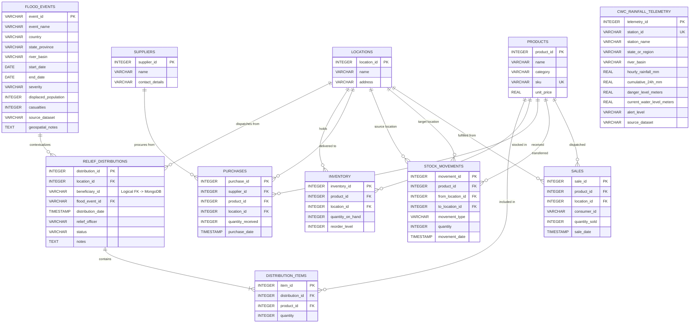
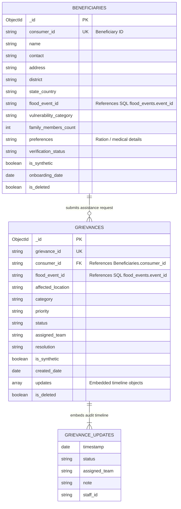

# TRACCIA: Database Management for Inventory and Disaster Response

TRACCIA is a hybrid database-centric application combining a relational SQL engine (PostgreSQL/MySQL/SQLite) and a document-oriented MongoDB store. It is optimised for Indian operational requirements and incorporates Nepal flood data as a disaster-response case study.

---

## 1. Project Overview & Datasets

### A. System Role
- **SQL Relational Engine**: Manages structured relief inventory, humanitarian procurement, multi-echelon disaster warehouse depots, atomic multi-item relief distribution transactions, and historical flood telemetry records.
- **MongoDB Document Store**: Manages flexible citizen/beneficiary onboarding profiles, field assistance requests, and evolving multi-stakeholder grievance resolution lifecycles with embedded audit timelines.
- **Hybrid Cross-Database Integration**: Links SQL relief distribution dispatches with MongoDB beneficiary records and connects geospatial flood events to field assistance requests.

### B. Dataset Sources Incorporated
1. **Nepal Flood Dataset**: [Nepal-FRES: 2021 Melamchi Flood Data](https://hydroshare.cuahsi.org/resource/b6da096000284d5882d13b085b7669ac/)
   - Geospatial information on landslides, debris flows, riverbed aggradation, and landscape changes associated with the June 2021 Melamchi flash flood in Sindhupalchok District, Nepal.
2. **Indian Flood Dataset**: [India Flood Inventory and Impacts (1967–2023)](https://zenodo.org/records/16994648)
   - Historical flood event, severity, casualty, and population displacement data across Indian states and river basins (e.g. 2018 Kerala floods, 2019 Bihar floods, 2020 Assam Brahmaputra floods, 2021 Uttarakhand Chamoli disaster).
3. **Hydrological Telemetry Dataset**: [CWC Hourly Rainfall Data](https://nwdp.nwic.gov.in/dataset/rainfall-cwc-telemetry-hourly)
   - Central Water Commission (CWC) telemetry observations providing river gauge water levels, hourly rainfall (mm), danger marks, and early flood warning alerts.
4. **Beneficiary & Grievance Records**: Sourced separately as clearly labelled synthetic data mapped to disaster event references.

---

## 2. Entity-Relationship (ER) Architecture

### SQL Relational Schema Diagram

---

### MongoDB Document Model Diagram

---

## 3. Database Operations & Verification

### SQL Operations
1. **CRUD**: Full lifecycle for products, suppliers, disaster warehouse locations, flood events, and CWC telemetry.
2. **JOIN Operations**:
   - 3-Way JOIN for stock levels (`inventory` + `products` + `locations`).
   - 4-Way JOIN for incoming humanitarian procurement (`purchases` + `suppliers` + `products` + `locations`).
   - 5-Way JOIN for relief distribution tracking (`relief_distributions` + `distribution_items` + `products` + `locations` + `flood_events`).
3. **Aggregate Queries (GROUP BY, HAVING)**:
   - Total stock units by warehouse hub.
   - Procurement order volume and units supplied by relief agency (`HAVING SUM(pu.quantity_received) > 0`).
   - Dispatched relief supplies and valuation by product category (`HAVING SUM(di.quantity) > 0`).
   - Disaster operations summary: Relief volume and total valuation aggregated by flood event (`GROUP BY fe.event_id`).
   - Low inventory deficit threshold alerts (`WHERE quantity_on_hand <= reorder_level`).
4. **ACID Transactions**:
   - `record_purchase`: Atomically logs purchase order and increments inventory buffer.
   - `record_relief_distribution`: Verifies stock availability, atomically decrements inventory across all line items, logs master distribution and items, and synchronizes sales tracking. Rolls back atomically on stock deficit.
   - `record_stock_movement`: Validates source depot stock and transfers units atomically.

### MongoDB Operations
1. **Beneficiary Profile Onboarding**:
   - Strict unique index on `consumer_id`.
   - Disaster vulnerability tagging (`DISPLACED_FAMILY`, `ELDERLY`, `CHILD_CARE`, `FEMALE_HEADED_HOUSEHOLD`).
   - Soft deletion pattern preserving transactional audit trails.
2. **Grievance Lifecycle Tracking**:
   - Assistance request filing across categories: `DRINKING_WATER`, `FOOD_RATIONS`, `EMERGENCY_SHELTER`, `TRAUMA_MEDICINE`, `RESCUE_ASSISTANCE`, `INFRASTRUCTURE_HAZARD`.
   - Embedded `$push` updates timeline maintaining immutable timestamps and staff audit identifiers.
   - Filtered retrieval by status (`OPEN`, `IN_PROGRESS`, `RESOLVED`), priority (`CRITICAL`, `HIGH`, `MEDIUM`, `LOW`), and flood event ID.
